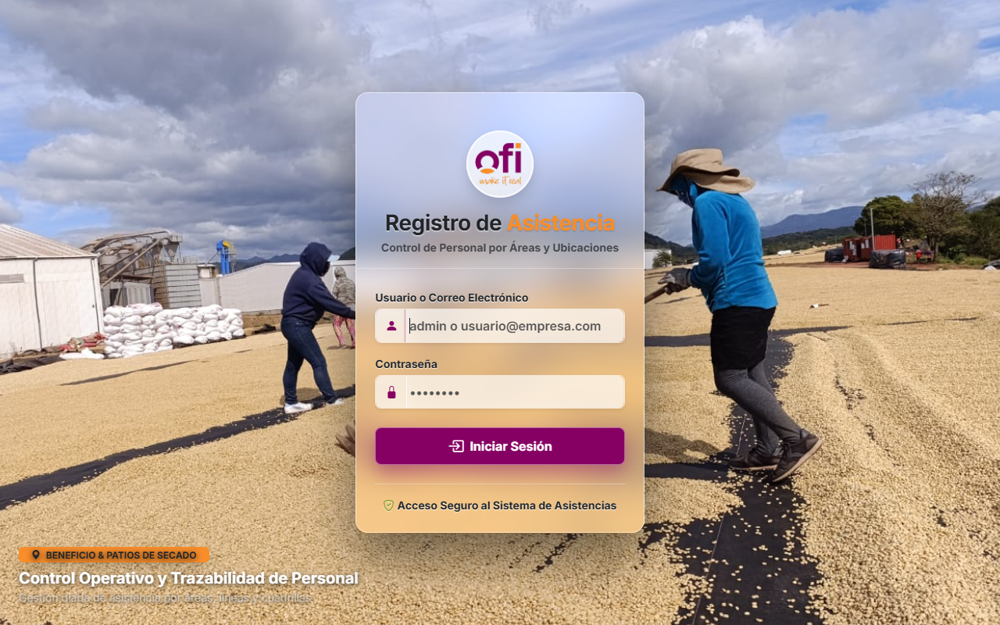
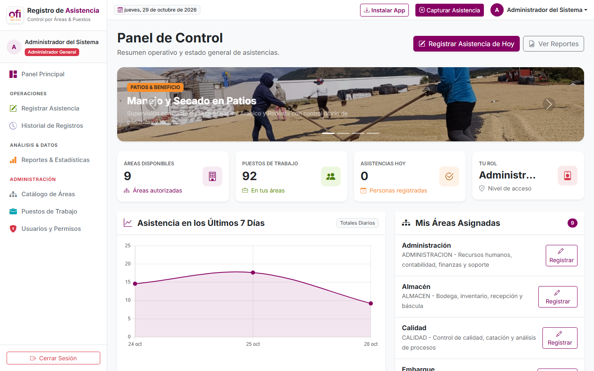
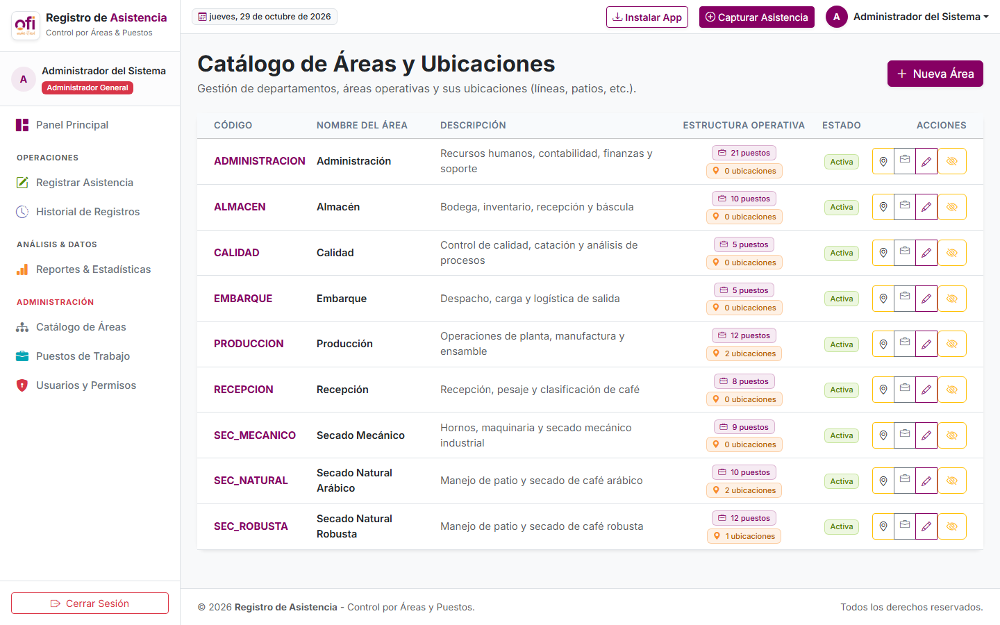
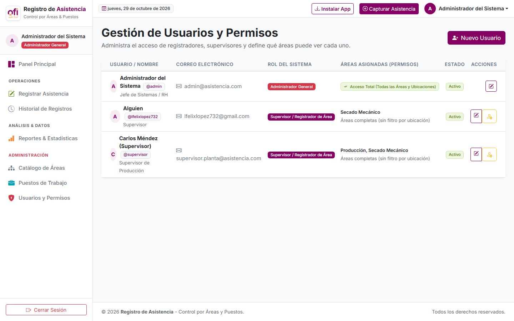
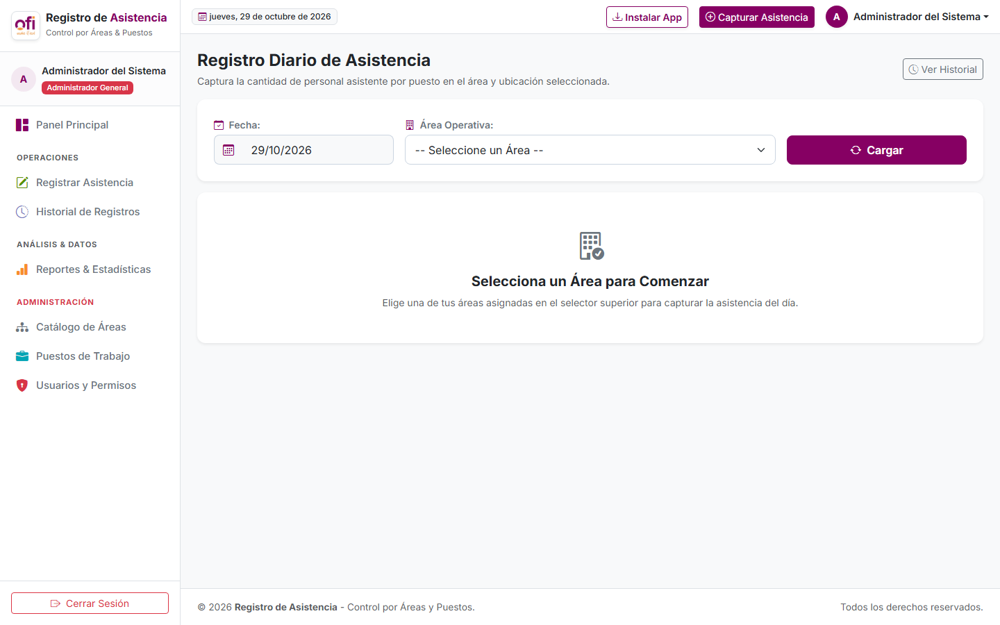
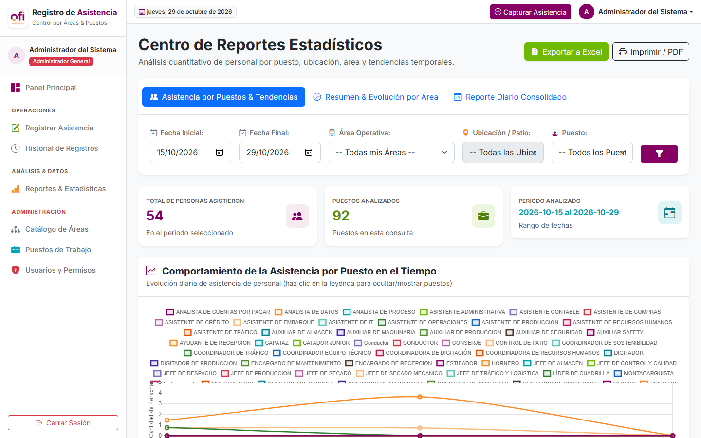

# 📖 Manual de Usuario - Sistema de Control de Asistencia y Personal RH

---

## 📋 Tabla de Contenido
1. [Introducción y Objetivos](#1-introducción-y-objetivos)
2. [Acceso al Sistema (Login)](#2-acceso-al-sistema-login)
3. [Panel Principal (Dashboard General)](#3-panel-principal-dashboard-general)
4. [Gestión de Áreas y Ubicaciones](#4-gestión-de-áreas-y-ubicaciones)
5. [Administración de Usuarios y Permisos Granulares](#5-administración-de-usuarios-y-permisos-granulares)
6. [Registro y Captura Diaria de Asistencia](#6-registro-y-captura-diaria-de-asistencia)
7. [Historial y Consulta de Asistencias](#7-historial-y-consulta-de-asistencias)
8. [Centro de Reportes Analíticos, Puestos y Tendencias](#8-centro-de-reportes-analíticos-puestos-y-tendencias)
9. [Preguntas Frecuentes y Soporte](#9-preguntas-frecuentes-y-soporte)

---

## 1. Introducción y Objetivos

El **Sistema de Control de Asistencia RH** es una solución corporativa diseñada para registrar, auditar y analizar la presencia y labores del personal operativo y administrativo en fincas, plantas procesadoras de café y oficinas centrales.

### Principales Funcionalidades:
- **Gestión Jerárquica**: Organización por **Áreas de Trabajo** (Producción, Patios de Secado, Molino, etc.) y **Ubicaciones Específicas** (ej. *ARÁBIGA*, *ROBUSTA*, *Patio Central*, *Patio Oficinas*).
- **Seguridad y Confidencialidad**: Supervisores asignados únicamente a las áreas y ubicaciones que les competen.
- **Captura Ágil**: Registro de jornada completa o media jornada por puesto y turno.
- **Analítica Avanzada**: Estadísticas de personal por puesto (patieros, punteros, clasificadores, etc.), gráficas de comportamiento en el tiempo y exportación inmediata a Excel.

---

## 2. Acceso al Sistema (Login)

Para ingresar a la plataforma, abra su navegador web e introduzca la URL provista por el departamento de TI.

### Pasos para iniciar sesión:
1. Ingrese su **Nombre de Usuario** o **Correo Electrónico Corporativo**.
2. Escriba su **Contraseña**.
3. Haga clic en el botón **Ingresar al Sistema**.

> **Nota:** La pantalla de inicio cuenta con un carrusel panorámico en alta definición con escenas del proceso del café y un formulario translúcido con efecto *Glassmorphism* para una experiencia visual agradable y moderna.

---

## 3. Panel Principal (Dashboard General)

Al acceder con un rol administrativo, se presenta el panel de control con los indicadores clave de desempeño (KPIs) en tiempo real.

### Elementos clave del Dashboard:
- **Banner de Estado Operativo**: Muestra la fecha del sistema, estado del turno actual y carrusel visual de procesos.
- **Tarjetas Métricas (KPIs)**:
  - Total de Empleados registrados.
  - Asistencias marcadas en el día de hoy.
  - Porcentaje de puntualidad y ausentismo.
- **Gráficos Dinámicos**: Distribución de personal por área operativa y tendencia semanal de asistencia.

---

## 4. Gestión de Áreas y Ubicaciones

El sistema permite segmentar las instalaciones en **Áreas** principales y **Ubicaciones** secundarias (por ejemplo, dentro del área *PRODUCCIÓN* coexisten *ARÁBIGA* y *ROBUSTA*; en *PATIOS DE SECADO* coexisten *Patio 1*, *Patio Oficinas*, etc.).

### ¿Cómo agregar y administrar Ubicaciones?
1. Diríjase a **Configuración > Áreas** en el menú lateral.
2. En la tabla de áreas, localice el área deseada.
3. En la columna **Ubicaciones**, haga clic en el botón **"Gestionar (X)"**.
4. En la ventana modal que se despliega:
   - Podrá visualizar la lista de ubicaciones existentes y su estado (*Activa / Inactiva*).
   - En el campo de texto superior, escriba el nombre de la nueva ubicación (ej. `PATIO OFI`).
   - Opcionalmente agregue una breve descripción y haga clic en **Guardar Ubicación**.
   - Los cambios se actualizan de forma inmediata sin recargar la página.

---

## 5. Administración de Usuarios y Permisos Granulares

Cada supervisor o usuario del sistema debe tener restringido su acceso únicamente a los sectores físicos donde tiene autoridad.

### Pasos para asignar Áreas y Ubicaciones a un Supervisor:
1. Diríjase a **Configuración > Usuarios**.
2. Haga clic en **Nuevo Usuario** o en el botón **Editar** de un usuario existente.
3. En la sección **Áreas Autorizadas**, marque las casillas de las áreas que supervisa.
4. Al seleccionar un área, se habilitará la sección jerárquica de **Ubicaciones Autorizadas**:
   - Marque las ubicaciones correspondientes (ej. un supervisor de producción asignado solo a *ROBUSTA* no podrá ver ni capturar en *ARÁBIGA*).
5. Asigne el rol del usuario (*Supervisor de Asistencia* o *Administrador*).
6. Haga clic en **Guardar Cambios**.

---

## 6. Registro y Captura Diaria de Asistencia

Este es el módulo central para los supervisores en cada jornada. Permite reportar la presencia física del personal clasificado por puesto y ubicación.

### Flujo de Captura:
1. Ingrese a **Asistencias > Registro Diario**.
2. Seleccione la **Fecha** de la jornada.
3. Seleccione el **Área** (ej. *Producción* o *Secado Natural*).
4. Seleccione la **Ubicación** correspondiente (ej. *ARÁBIGA*, *Patio Ofi*, etc.). El selector solo mostrará las ubicaciones activas autorizadas para su usuario.
5. Indique el **Turno** (Matutino, Vespertino o Nocturno).
6. En la cuadrícula de puestos (ej. *Operador de Maquinaria*, *Patiero*, *Puntero*, *Pesador*):
   - Ingrese la cantidad de personas que cumplieron **Día Completo (1.0)**.
   - Ingrese la cantidad de personas que laboraron **Medio Día (0.5)**.
7. Añada cualquier observación o novedad en el campo de texto inferior.
8. Haga clic en **Guardar Asistencia**. El sistema confirmará el guardado exitoso con una alerta verde.

---

## 7. Historial y Consulta de Asistencias

Permite auditar y revisar todos los registros guardados en días previos.

### Características del Historial:
- **Filtros por Fecha**: Consulte por día específico o rangos de fechas.
- **Filtro por Ubicación y Área**: Aísle los registros de una ubicación puntual.
- **Trazabilidad de Auditoría**: Identifica qué usuario realizó el registro, la fecha/hora exacta de creación y si hubo modificaciones.
- **Edición Rápida**: Si cuenta con permisos, puede corregir conteos en caso de reclamos o ajustes de nómina.

---

## 8. Centro de Reportes Analíticos, Puestos y Tendencias

El módulo de reportes ofrece analítica profunda para la toma de decisiones, control de costos de mano de obra y auditoría de productividad.

### Opciones de Análisis:

#### A. Desglose de Personal por Puestos
Al consultar un área o ubicación (por ejemplo *Secado Natural - Patio Ofi*):
- El reporte desglosa con exactitud el número de personas registradas en cada puesto: cuántos **Patieros**, cuántos **Punteros**, etc.
- Muestra el **Total de Personas**, los equivalentes en **Jornales Trabajados**, el porcentaje de participación de cada puesto y el promedio diario de personal.

#### B. Gráfico Interactivo de Comportamiento Temporal
- Al filtrar por un **Rango de Fechas**, el sistema genera automáticamente un **Gráfico de Líneas** interactivo (Chart.js) que muestra la evolución día por día.
- Permite comparar picos de demanda de personal a lo largo de la semana o mes.

#### C. Filtro Específico por Puesto
- En la barra de filtros, utilice el selector **"Filtrar por Puesto"** para aislar un cargo específico (ej. examinar únicamente la asistencia de los *Patieros* a lo largo del mes).
- La gráfica y la tabla resumen se sincronizan automáticamente para reflejar solo el puesto seleccionado.

#### D. Exportación a Microsoft Excel
- Haga clic en el botón verde **Exportar a Excel (.xlsx)** para descargar de inmediato un reporte estructurado y listo para el departamento de Nómina y Recursos Humanos.

---

## 9. Preguntas Frecuentes y Soporte

### ❓ ¿Qué ocurre si un supervisor intenta registrar en una ubicación no asignada?
El sistema valida en el servidor tanto la sesión como los permisos asignados. Si un usuario intenta acceder a una ubicación ajena, el sistema denegará la petición y emitirá un mensaje de advertencia.

### ❓ ¿Se pueden registrar dos turnos en la misma ubicación el mismo día?
Sí. El sistema permite registrar independientemente el turno de la mañana, de la tarde y la noche para la misma ubicación y fecha.

### ❓ ¿Cómo reportar un error o solicitar un nuevo puesto?
Comuníquese con el Administrador General del Sistema o con el departamento de TI indicando el código del área y el nombre del puesto requerido.

---

*Manual elaborado para el Sistema de Control de Asistencia RH - Versión Corporativa 2026.*
